
<a href="./README.md">繁體中文</a> · English

<picture>
  <source media="(max-width: 600px)" srcset="./cards/en/hero-mobile.svg">
  
</picture>

<picture>
  <source media="(max-width: 600px)" srcset="./cards/en/calendar-mobile.svg">
  
</picture>

<picture>
  <source media="(max-width: 600px)" srcset="./cards/en/activity-mobile.svg">
  
</picture>

<a href="https://github.com/AllenXiao1230/rocafa_2026"><picture>
  <source media="(max-width: 600px)" srcset="./cards/en/tile-0-mobile.svg">
  
</picture></a>
<a href="#photography-tools"><picture>
  <source media="(max-width: 600px)" srcset="./cards/en/tile-1-mobile.svg">
  
</picture></a>
<a href="https://github.com/AllenXiao1230/veyra"><picture>
  <source media="(max-width: 600px)" srcset="./cards/en/tile-2-mobile.svg">
  
</picture></a>

## Selected work

### Photography tools

<a href="https://github.com/AllenXiao1230/fuji-recipe-manager">
<picture>
  <source media="(max-width: 600px)" srcset="./cards/en/project-fuji-recipe-manager-mobile.svg">
  
</picture>
</a>

<a href="https://github.com/AllenXiao1230/Cadris">
<picture>
  <source media="(max-width: 600px)" srcset="./cards/en/project-Cadris-mobile.svg">
  
</picture>
</a>

### Web & automation

<a href="https://github.com/AllenXiao1230/veyra">
<picture>
  <source media="(max-width: 600px)" srcset="./cards/en/project-veyra-mobile.svg">
  
</picture>
</a>

<a href="https://github.com/AllenXiao1230/rocafa_2026">
<picture>
  <source media="(max-width: 600px)" srcset="./cards/en/project-rocafa_2026-mobile.svg">
  
</picture>
</a>

<a href="https://github.com/AllenXiao1230/motion_detection_cctv">
<picture>
  <source media="(max-width: 600px)" srcset="./cards/en/project-motion_detection_cctv-mobile.svg">
  
</picture>
</a>

<a href="https://github.com/AllenXiao1230?tab=repositories">
<picture>
  <source media="(max-width: 600px)" srcset="./cards/en/footer-mobile.svg">
  
</picture>
</a>

Contribution snapshot: 2026-11-28 · Public GitHub calendar · Refreshed daily with GitHub Actions.
