繁體中文 · <a href="./README.en.md">English</a>

<picture>
  <source media="(max-width: 600px)" srcset="./cards/zh-TW/hero-mobile.svg">
  
</picture>

<picture>
  <source media="(max-width: 600px)" srcset="./cards/zh-TW/calendar-mobile.svg">
  
</picture>

<picture>
  <source media="(max-width: 600px)" srcset="./cards/zh-TW/activity-mobile.svg">
  
</picture>

<a href="https://github.com/AllenXiao1230/rocafa_2026"><picture>
  <source media="(max-width: 600px)" srcset="./cards/zh-TW/tile-0-mobile.svg">
  
</picture></a>
<a href="#攝影工具"><picture>
  <source media="(max-width: 600px)" srcset="./cards/zh-TW/tile-1-mobile.svg">
  
</picture></a>
<a href="https://github.com/AllenXiao1230/veyra"><picture>
  <source media="(max-width: 600px)" srcset="./cards/zh-TW/tile-2-mobile.svg">
  
</picture></a>

## 精選作品

### 攝影工具

<a href="https://github.com/AllenXiao1230/fuji-recipe-manager">
<picture>
  <source media="(max-width: 600px)" srcset="./cards/zh-TW/project-fuji-recipe-manager-mobile.svg">
  
</picture>
</a>

<a href="https://github.com/AllenXiao1230/Cadris">
<picture>
  <source media="(max-width: 600px)" srcset="./cards/zh-TW/project-Cadris-mobile.svg">
  
</picture>
</a>

### 網頁與自動化

<a href="https://github.com/AllenXiao1230/veyra">
<picture>
  <source media="(max-width: 600px)" srcset="./cards/zh-TW/project-veyra-mobile.svg">
  
</picture>
</a>

<a href="https://github.com/AllenXiao1230/rocafa_2026">
<picture>
  <source media="(max-width: 600px)" srcset="./cards/zh-TW/project-rocafa_2026-mobile.svg">
  
</picture>
</a>

<a href="https://github.com/AllenXiao1230/motion_detection_cctv">
<picture>
  <source media="(max-width: 600px)" srcset="./cards/zh-TW/project-motion_detection_cctv-mobile.svg">
  
</picture>
</a>

<a href="https://github.com/AllenXiao1230?tab=repositories">
<picture>
  <source media="(max-width: 600px)" srcset="./cards/zh-TW/footer-mobile.svg">
  
</picture>
</a>

貢獻資料日期：2026-11-24 · GitHub 公開貢獻紀錄 · 由 GitHub Actions 每日更新。
